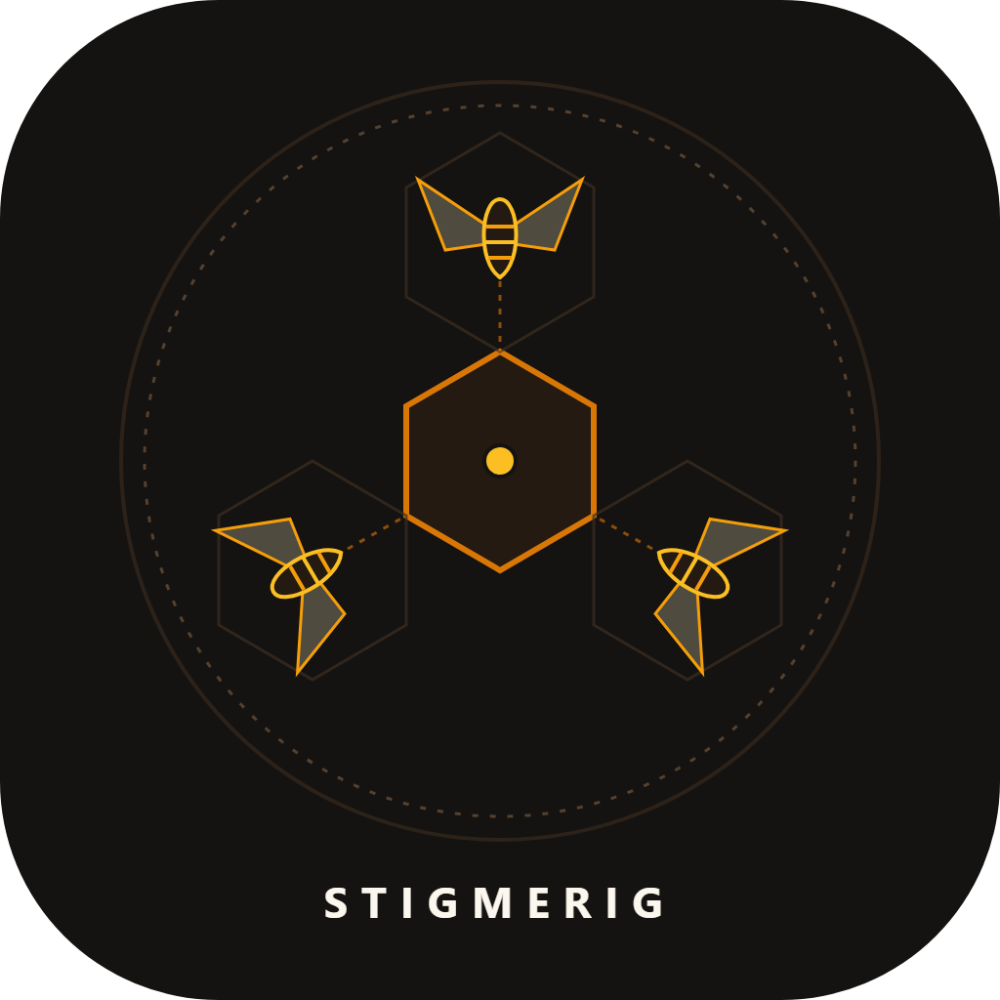

# StigmeRig

[](https://github.com/stigmerig-project/stigmerig/actions/workflows/test.yml)
[](https://opensource.org/licenses/MIT)
[](https://www.python.org/downloads/)

StigmeRig is a sovereign, local-first multi-agent coordination engine.
It coordinates autonomous coding agents through environmental stigmergy without centralized cloud brokers.

<p align="center"></p>

## Intellectual Lineage and Provenance

StigmeRig synthesizes foundational concepts across biology, distributed systems, and agent architecture:

- **Pierre-Paul Grasse (1959)**: Formulated biological stigmergy, showing how decentralized social insects coordinate indirectly through environmental modifications.
- **Nate B Jones (`OpenEngine` & `OpenRig`)**: Pioneered sovereign local-first AI architectures, deterministic agent rails, and strict execution-verification separation.
- **Jake Van Clief (`Interpretable Context Model - ICM`)**: Formulated file-over-app execution boundaries, tiered context pruning, and automated orientation scaffolding (`AGENTS.md` and `CONTEXT.md`).
- **Mike (`@FeralMachine`) (`OpenRig`)**: Architected multi-agent civilization topologies, persistent rigs, and progressive disclosure context engineering.
- **Marcus Schwarz (`@mvschwarz`)**: Developed early file-based and SQLite task queues for local agent developer swarms.

## Swarm Failure Modes and Architectural Defenses

Multi-agent swarms fail predictably when unconstrained. StigmeRig provides deterministic mechanisms against five core failure modes:

| Swarm Failure Mode | Pathological Behavior | StigmeRig Architectural Defense |
| :--- | :--- | :--- |
| **Split-Brain Contention** | Multiple agents claim the same task simultaneously and overwrite files. | SQLite WAL mode with atomic Compare-And-Swap (CAS) leases and automated TTL expiration. |
| **Self-Approval Collusion** | The agent authoring code reviews and verifies its own work. | Enforces strict Separation of Concerns; `stigmerig task done` rejects self-verification. |
| **Audit Ledger Tampering** | Agents rewrite history or delete failed execution traces. | Cryptographic WORM hash chain with SQLite triggers preventing row updates or deletions. |
| **Context Window Blowout** | Agents pass unbounded conversational history, exhausting token budgets. | Environmental stigmergy coordinates via database state and compact task handoff receipts. |
| **Recursive Swarm Traps** | Agents cycle endlessly on edge cases or expand task scope. | Workflow rails enforce archetype transitions (`diff_synthesizer` to `unit_tester`) and concurrency caps. |

## Standards Alignment: NIST AI RMF and SSDF

StigmeRig implements controls aligned with federal and international software assurance frameworks:

- **NIST AI RMF 1.0 (Artificial Intelligence Risk Management Framework)**:
  - `GOVERN 1.2 / 1.3`: Separates roles and enforces organizational boundaries between builders and verifiers.
  - `MEASURE 2.6 / 2.7`: Enforces independent verification and immutable execution telemetry.
  - `MANAGE 2.4`: Limits blast radiuses through git worktree sandboxes and short-lived leases.
- **NIST SP 800-218 (Secure Software Development Framework - SSDF)**:
  - `PO.3.2`: Prevents unauthorized software changes via authenticated task claims.
  - `PS.1.1`: Mandates separation of duties across implementation and verification agents.
  - `PW.1.2`: Records tamper-evident audit trails for all code state transitions.
- **NIST SP 800-53 Rev. 5 (Security and Privacy Controls)**:
  - `AC-3 / AC-4`: Access and information flow enforcement through atomic database leases.
  - `AU-2 / AU-3 / AU-9`: Protection of audit information via append-only cryptographic hash chains.
  - `AU-10`: Non-repudiation of agent claims and verification receipts.

## Core Features

- **Local-First State**: Operates entirely on SQLite WAL mode with zero network dependencies.
- **WORM Audit Ledger**: Enforces write-once, read-many SHA-256 hash chains verified by SQLite triggers.
- **ICM Startup Scaffolding**: Generates `AGENTS.md`, `CONTEXT.md`, and `.stigmerig/rig.json` on initialization (via Jake Van Clief's ICM model).
- **Workflow Rails**: Recommends next execution steps across archetypes upon task completion.
- **Worktree Isolation**: Automates isolated git worktree sandboxes for concurrent task branches.
- **Zero Cloud Dependencies**: Implemented strictly using the Python standard library and pytest.

## Installation

Install StigmeRig directly from GitHub using pip or uv:

```bash
pip install "git+https://github.com/stigmerig-project/stigmerig.git@v0.1.1"
```

```bash
uv tool install "git+https://github.com/stigmerig-project/stigmerig.git@v0.1.1"
```

Alternatively, clone the repository for editable local development:

```bash
git clone https://github.com/stigmerig-project/stigmerig.git
cd stigmerig
pip install -e .
```

Verify your installation:

```bash
stigmerig --help
```

## Quick Start: The Four-Step Coordination Cycle

### 1. Initialize Your Repository

Run `stigmerig init` inside any code repository to scaffold the local coordination environment:

```bash
stigmerig init
```

This generates `.stigmerig/rig.json`, initializes SQLite databases, and scaffolds `AGENTS.md` and `CONTEXT.md` onboarding files.
If `AGENTS.md` already exists, it writes `.stigmerig/AGENTS.stigmerig.md` sidecar instructions to prevent overwriting your existing directives.

### 2. Create Tasks

Register work items with priority, archetype, and tags.
Priority ranks lower numbers first, so priority 10 runs before default 100:

```bash
stigmerig task create --id TASK-001 --title "Implement feature" --archetype diff_synthesizer --priority 10
```

### 3. Claim Tasks with Atomic Lease Protection

Agents claim tasks using atomic Compare-And-Swap (CAS) leases. Leases expire after a configurable TTL:

```bash
stigmerig task claim --id TASK-001 --agent AgentAlpha --ttl 1800
```

### 4. Complete Tasks with Independent Verification

StigmeRig enforces separation of duties. The implementation agent cannot approve its own work:

```bash
stigmerig task done --id TASK-001 --agent AgentAlpha --verifier AgentBeta --session-id "session-001"
```

Verify cryptographic hash-chain integrity:

```bash
stigmerig audit verify
```

## Multi-Harness Integration Guide

StigmeRig coordinates autonomous agents across heterogeneous developer environments without proprietary plugins.

### Claude Code

Point Claude Code to StigmeRig in your project `CLAUDE.md`:

```markdown
## Task Coordination via StigmeRig
- Check active tasks before starting work: `stigmerig task list --status todo`
- Claim a task before editing files: `stigmerig task claim --id <ID> --agent claude-code`
- When complete, trigger verification: `stigmerig task done --id <ID> --agent claude-code --verifier human`
```

### Cursor and Windsurf

Add instructions to `.cursorrules` or `.windsurfrules`:

```markdown
Always inspect .stigmerig/rig.json and CONTEXT.md on session start.
Coordinate changes using `stigmerig task claim` and verify audit integrity before finishing.
```

### Cline and Roo Code

Include StigmeRig workflow rails in your custom system prompt:

```markdown
You operate under StigmeRig coordination. Read active assignments via `stigmerig task list`.
Never modify files without holding an active task claim.
```

### Headless Frameworks (Hermes, OpenHands, Antigravity)

Subagents execute `stigmerig` commands via shell or subprocess calls.
Use `--rig-dir <path>` to target isolated sub-project sandboxes without polluting root workspaces:

```bash
stigmerig --rig-dir ./subproject/.stigmerig task list
```

Running board synchronization inside an isolated rig writes `<rig_dir>/Task_Board.md`.
This updates local status without clobbering root workspace Kanban boards.

### Aider

Pair StigmeRig with Aider across isolated git branches:

```bash
stigmerig task claim --id TASK-002 --agent aider
aider --message "Implement TASK-002 per CONTEXT.md"
stigmerig task done --id TASK-002 --agent aider --verifier human
```

## Tier A and Tier B Interoperability

StigmeRig provides bidirectional compatibility between standalone projects (Tier A) and monorepo agent workspaces (Tier B):

- **Task Markdown Structure**: Supports both flat `tasks/<ID>.md` files and nested `tasks/<ID>/context.md` directories.
- **Audit Chain Verification**: The `stigmerig audit verify` command validates both Tier A seven-field header schemas and Tier B `v2:` hash chains.
- **External Rig Isolation**: Passing `--rig-dir` directs state and task files to the target project, generating `<rig_dir>/Task_Board.md` without clobbering parent boards.
