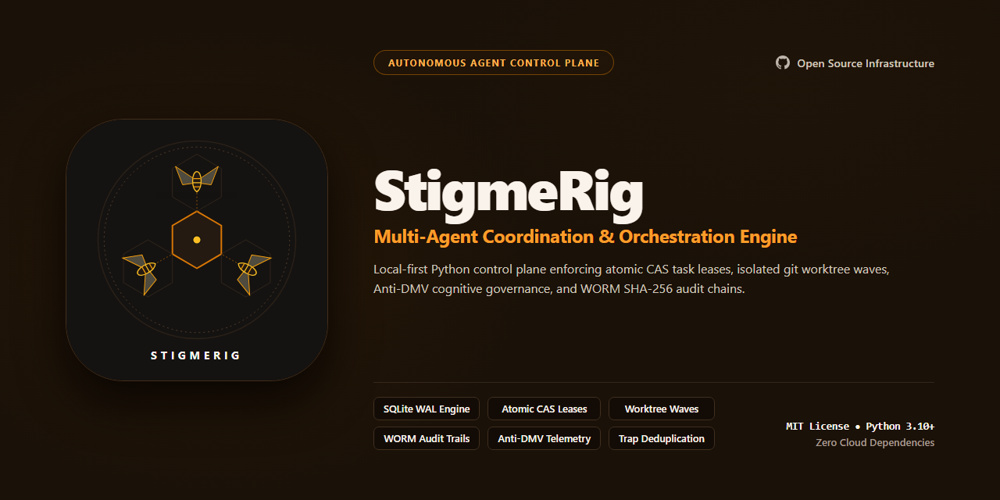
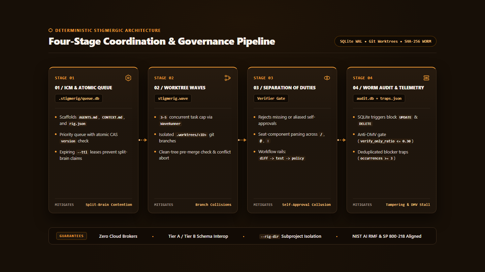

# StigmeRig

[](https://github.com/stigmerig-project/stigmerig/actions/workflows/test.yml)
[](https://opensource.org/licenses/MIT)
[](https://www.python.org/downloads/)

StigmeRig is a sovereign, local-first multi-agent coordination engine.
It coordinates autonomous coding agents through environmental stigmergy without centralized cloud brokers.



## Quick Install

Install StigmeRig from GitHub with `pip` or `uv`:

```bash
pip install "git+https://github.com/stigmerig-project/stigmerig.git@v0.1.9"
uv tool install "git+https://github.com/stigmerig-project/stigmerig.git@v0.1.9"
stigmerig --help
```

## Design Context

StigmeRig applies biological stigmergy (Grasse, 1959) so agents coordinate via SQLite state instead of long prompt chains.
Following Brooks and Goldratt, it caps wave concurrency and requires verification receipts to prevent integration bottlenecks.
See [docs/ARCHITECTURE_LINEAGE.md](docs/ARCHITECTURE_LINEAGE.md) for full provenance and empirical background.

## Control Plane Architecture

StigmeRig structures autonomous work across a five-stage deterministic pipeline backed by SQLite WAL state and git worktrees.



1. **ICM and Atomic Queue (`.stigmerig/queue.db`)**: Scaffolds orientation files and coordinates claims with Compare-And-Swap leases and review-queue backpressure.
2. **Worktree Waves (`stigmerig.wave`)**: Bounds concurrent execution to 3 to 5 tasks inside isolated `.worktrees/<ID>` git branches.
3. **Asynchronous Review State (`task review`)**: Transitions completed work to review status, clears leases, and records SHA-256 evidence.
4. **Separation of Duties (`task approve`)**: Blocks self-approvals, enforces Intentional Friction policies, and records independent verifier signatures.
5. **Append-Only Audit and Telemetry (`audit.db` and `traps.json`)**: Enforces trigger-protected SHA-256 hash chains, bottleneck metrics, and deduplicated blocker traps.

## Swarm Failure Modes and Architectural Defenses

Multi-agent swarms fail predictably when unconstrained. StigmeRig provides deterministic defenses against twelve failure modes:

| Swarm Failure Mode | Pathological Behavior | StigmeRig Architectural Defense |
| :--- | :--- | :--- |
| **Split-Brain Contention** | Multiple agents claim the same task simultaneously and overwrite files. | SQLite WAL mode with atomic Compare-And-Swap (CAS) `version` leases and automated `--ttl` expiration. |
| **Self-Approval Collusion** | An implementing agent reviews or approves its own changes via identity aliases. | Rejects missing verifiers and parses composite seat components across `/`, `@`, and `:` delimiters. |
| **Audit Ledger Tampering** | Agents rewrite task history or delete failed execution traces. | Unkeyed SHA-256 hash chain with SQLite triggers blocking `UPDATE` and `DELETE` operations. |
| **Context Window Blowout** | Agents pass unbounded conversational history, exhausting token budgets. | Environmental stigmergy coordinates through compact SQLite state transitions and scoped task files. |
| **Recursive Swarm Traps** | Agents cycle endlessly on edge cases or expand task scope. | Workflow rails guide archetype transitions (`diff_synthesizer` to `unit_tester` to `policy_gatekeeper`). |
| **Verification Bureaucracy ("DMV Trap")** | Review ceremony outnumbers implementation work and stalls delivery. | Tracks `verify_only_ratio <= 0.30`, `dmv_alert`, and `ceremony_ratio` across leaf archetypes. |
| **Downstream Review Flood** | High-velocity agents generate excessive pull requests that overwhelm reviewer capacity and stall releases. | Atomic review-queue backpressure (`max_pending_review`) in `rig.json` throttles new claims until reviews complete. |
| **Unverified Critical-Path Self-Approval** | Autonomous agents bypass oversight or self-approve high-risk security, infrastructure, or release tasks. | Intentional Friction gates (`high_friction_tags`, `high_friction_globs`) forbid self-approval and mandate SHA-256 evidence. |
| **Brownfield Trap Overload** | Enabling strict static traps on mature legacy repositories produces overwhelming scan noise and blocks adoption. | Baseline ratchets (`--baseline` and `--write-baseline`) snapshot legacy violations and fail only on net-new infractions. |
| **Amnesiac Repeat Failures** | Agents hit identical blockers repeatedly without retaining institutional memory. | Deduplicates normalized failure signatures in `.stigmerig/traps.json`, flagging `promotion_candidate` at `occurrences >= 3`. |
| **Parallel Branch Collisions** | Concurrent workers corrupt shared working trees or leave half-merged conflicts. | `WorktreeManager` and `WaveRunner` enforce 3 to 5 wave caps, clean-tree checks, and `git merge --abort` rollback. |
| **Parent-Board Clobbering** | Subproject swarms overwrite root workspace queues, boards, or trap registries. | `--rig-dir` and `STIGMERIG_ROOT` isolate local `queue.db`, `<rig_dir>/Task_Board.md`, and `<rig_dir>/traps.json`. |

## Threat Model and Scope Boundaries

StigmeRig coordinates cooperative local agents inside a shared repository. It is not a kernel sandbox or asymmetric non-repudiation gateway.

- **Local Process Isolation**: Git worktrees, resolved path containment, and atomic SQLite leases isolate concurrent branch edits and block path escapes.
- **Cooperative Identity Boundaries**: CLI flags (`--agent`, `--verifier`) enforce workflow separation and anti-self-approval rails across cooperative processes rather than adversarial OS boundaries.
- **Optional External Sandboxes**: Pair StigmeRig with external containers (Docker, Podman, Firecracker), proxies, or model gateways for untrusted code or network isolation.
- **Target Scale (`1-5` Engineers)**: Built for small teams and under `50` active tasks on the Python standard library (`dependencies = []`) with zero background daemons.
- **Excluded Overhead**: Per-task file allowlists (`--allowed-globs`), local HMAC key rotation, lockfile re-hashing, issue-polling mirrors, and embedded vector stores stay external to protect velocity.

## Security and Concurrency Invariants (v0.1.9)

StigmeRig enforces operational security and concurrency invariants across all workflows:

- **Lease-Bound Compare-And-Swap (`CAS`) Transitions**: Status changes verify active lease ownership, unexpired timestamps, and atomic version checks. Parent epics also verify child task completion before closing.
- **Review and Approval Separation**: `task review` transitions tasks to `review`, clears the lease, and binds SHA-256 evidence. `task approve` transitions `review` to `done` and enforces distinct verifiers.
- **Atomic Review-Queue Backpressure**: SQLite subqueries throttle new claims when pending reviews reach `max_pending_review` in `rig.json`.
- **Intentional Friction on Critical Paths**: Tasks matching `high_friction_tags` or `high_friction_globs` forbid self-approval and require independent verification evidence.
- **Resolved Path Containment**: Task identifiers must match `^[A-Za-z0-9][A-Za-z0-9._-]{0,63}$`. Task files and `.worktrees/<TASK_ID>` directories enforce resolved path containment.
- **Forensic Worktree Retention**: When an action raises an exception, StigmeRig marks the task `blocked`. The runner retains the isolated worktree on disk for inspection.
- **Cooperative Trust Boundary**: CLI flags such as `--agent` and `--verifier` enforce workflow separation across cooperative local agents.

## Core Features

- **Local-First SQLite WAL State**: Coordinates concurrent readers and writers in `.stigmerig/queue.db` with zero network brokers.
- **Append-Only Audit Log (SQLite Triggers + Unkeyed SHA-256 Chain)**: Protects `.stigmerig/audit.db` with SHA-256 hash chaining and SQLite `BEFORE UPDATE` and `BEFORE DELETE` triggers.
- **Review-Queue Backpressure**: Atomic SQLite subqueries throttle builder claims when unreviewed tasks reach `max_pending_review`.
- **Intentional Friction and 4-Axis PR Rubric**: Blocks self-approval, requires SHA-256 evidence, attaches `high_friction_rubric`, and logs `scope_hygiene_warn` on removed test assertions.
- **ICM Startup Scaffolding and Sync**: Generates `AGENTS.md`, `CONTEXT.md`, and `.stigmerig/rig.json` with sidecar fallback. Verifies and syncs SHA-256 markers via `--check` and `--sync-icm`.
- **Composite Anti-Self-Approval Gate**: Blocks direct and aliased self-verification across `seat/agent`, `agent@host`, and `role:agent` identifiers.
- **Non-Blocking Follow-Up Spawning**: Repeatable `--follow-up` flags on `task done` and `task approve` atomically spawn top-level `FU-` backlog tasks.
- **Rolling Git Worktree Waves**: Executes 3 to 5 tasks per batch in `.worktrees/<ID>` with archetype commit attribution and `--no-ff` merges.
- **Anti-DMV and Wave Topology Telemetry**: Computes `verify_only_ratio`, `ceremony_ratio`, `review_wait_ratio`, epic `phase_depth`, and Mermaid handoff diagrams.
- **Subtractive Evergreen Telemetry and Freshness**: Tracks `@remove-when` expiration (`TRAP-EVG-001`), stale files, `net_loc_delta_total`, and `subtractive_task_count`.
- **Config-Driven Model Lineage and Tier Telemetry**: Maps archetype models via `rig.json` `archetype_models`, adds `WaveRunner` `Model:` trailers, and tracks `tier_overprovisioned_alert`.
- **Brownfield Baseline Ratchets**: Suppresses legacy violations using multiset fingerprints while catching net-new regressions.
- **Verification Trap Pack**: Catches skipped tests, blanket linter suppressions, and unverified documentation stubs.
- **Diff-Scoped Vacuous Test Guard**: Flags net-new tautological test assertions across worktree diffs and records vacuous_test_warn audit entries.
- **Rust Never-Crash Trap Pack**: Enforces `TRAP-RS-003` and `TRAP-RS-004` on production Rust code with lazy inline `#[cfg(test)]` masking.
- **Normalized Blocker Trap Harvesting**: Deduplicates recurring failure signatures in `.stigmerig/traps.json` and promotes persistent traps at three occurrences.
- **Zero Runtime Cloud Dependencies**: Built purely on the Python 3.10+ standard library (`sqlite3`, `argparse`, `hashlib`, `subprocess`).

## Quick Start: The Coordination Cycle

### 1. Initialize Your Repository

Run `stigmerig init` inside any code repository to scaffold the local coordination environment:

```bash
stigmerig init
```

This generates `.stigmerig/rig.json`, initializes SQLite databases, and scaffolds `AGENTS.md` and `CONTEXT.md` onboarding files.
If `AGENTS.md` already exists, it writes `.stigmerig/AGENTS.stigmerig.md` sidecar instructions to prevent overwriting your existing directives.
Check bounded `AGENTS.md` SHA-256 markers without SQLite writes, or sync them while preserving surrounding user rules:

```bash
stigmerig init --check
stigmerig init --sync-icm
```

### 2. Create Tasks

Register work items with priority, archetype, and tags.
Priority ranks lower numbers first, so priority 10 runs before default 100:

```bash
stigmerig task create --id TASK-001 --title "Implement feature" --archetype diff_synthesizer --priority 10
```

### 3. Claim Tasks with Atomic Lease Protection

Agents claim tasks using atomic Compare-And-Swap (CAS) leases. Leases expire after a configurable TTL:

```bash
stigmerig task claim --id TASK-001 --agent AgentAlpha --ttl 1800
```

Pass `--json` to return structured claim output. High-friction tasks attach a 4-axis `high_friction_rubric` in both `task claim --json` and `task get`:

```bash
stigmerig task claim --id TASK-001 --agent AgentAlpha --json
```

### 4. Submit Tasks for Asynchronous Review

Agents submit completed work for review with SHA-256 verification evidence:

```bash
stigmerig task review --id TASK-001 --agent AgentAlpha --summary "Implemented auth feature" --evidence auth.py
```

This transitions the task to `review`, clears the lease, and records SHA-256 evidence.

### 5. Approve Reviews and Verify Hash Chains

An independent verifier validates artifacts and closes the task:

```bash
stigmerig task approve --id TASK-001 --verifier AgentBeta --evidence auth.py
```

StigmeRig rejects approvals from agents that implemented the task.
If verification fails, a reviewer rejects the submission back to `blocked` for rework:

```bash
stigmerig task fail --id TASK-001 --agent AgentBeta --reason "Missing negative boundary test"
```

Direct completion remains supported for low-friction tasks:

```bash
stigmerig task done --id TASK-001 --agent AgentAlpha --verifier AgentBeta --session-id "session-001"
```

Attach repeatable `--evidence <path>` flags to bind verification artifacts to the completion event. Each path must resolve inside the repository root. StigmeRig hashes each file in 64 KiB chunks into `task_events.payload` and `audit.db` `payload_hash`.

Capture non-blocking findings during `task approve` or `task done` with repeatable `--follow-up` flags:

```bash
stigmerig task approve --id TASK-001 --verifier AgentBeta --follow-up "Add edge test coverage"
```

Each flag atomically spawns a top-level `FU-<ORIGIN>-<SEQ>` `todo` task without blocking parent epic closure.

Verify append-only SHA-256 hash chain integrity:

```bash
stigmerig audit verify
```

## Rolling Wave and Git Worktree Orchestration

Multi-process agents coordinate through `stigmerig` CLI claims, while `stigmerig.wave` pairs `WorktreeManager` with `WaveRunner` to run embedded Python callbacks across isolated worktrees.

```python
import subprocess
import sys
from pathlib import Path
from stigmerig.db import StigmeRigDB
from stigmerig.wave import WaveRunner, WorktreeManager

db = StigmeRigDB()
wt = WorktreeManager()
runner = WaveRunner(db=db, worktree_mgr=wt)

def run_tests(worktree_dir: Path) -> bool:
    return subprocess.run([sys.executable, "-m", "pytest", "-q"], cwd=worktree_dir, check=False).returncode == 0

results = runner.run_wave(
    [
        {
            "task_id": "TASK-001",
            "agent": "BuilderAlpha",
            "verifier": "TesterBeta",
            "archetype": "diff_synthesizer",
            "action": run_tests,
        }
    ],
    max_concurrency=3,
)
```

`WaveRunner` enforces six deterministic execution invariants:

- **Bounded Concurrency**: Clamps `max_concurrency` to a ceiling of 5 tasks per wave (recommended 3 to 5).
- **Isolated Task Branches**: Creates `.worktrees/<ID>` bound to branch `task/<ID>` before invoking the worker callback.
- **Archetype Git Attribution**: Commits staged changes under `<Swarm> [<archetype>]` author metadata and `<Swarm> [orchestrator]` committer metadata.
- **Safe Non-Fast-Forward Merge**: Verifies a clean worktree, merges with `git merge --no-ff`, or runs `git merge --abort` on conflict.
- **Model Lineage and Diff Metrics**: Appends resolved `Model:` commit trailers and records `lines_added`, `lines_deleted`, `net_loc_delta`, and `files_deleted`.
- **Worktree Test Diff Audits**: Logs `vacuous_test_warn` on net-new tautological test assertions and `scope_hygiene_warn` upon builder assertion deletions.

## Deterministic Telemetry and Trap Tracking

StigmeRig computes task durations, governance overhead, epic wave shapes, and recurring blockers directly from SQLite logs.

Render a human-readable Markdown summary table:

```bash
stigmerig telemetry metrics
```

Export structured metrics as JSON for automated CI gates or dashboards:

```bash
stigmerig telemetry metrics --json
```

Generate Mermaid sequence diagrams of agent handoffs with `stigmerig telemetry sequence`.

### Anti-DMV Governance Ratios

| Metric Group | Key Fields | Purpose |
| :--- | :--- | :--- |
| **Anti-DMV Ratios** | `verify_only_ratio`, `dmv_alert`, `ceremony_ratio` | Keeps verify-only leaf tasks (`unit_tester`, `prose_auditor`, `policy_gatekeeper`, `topology_reader`) `<= 0.30`. |
| **Rework & Review** | `rework_tasks`, `rework_rate`, `pending_review_tasks`, `review_wait_ratio`, `review_bottleneck_alert` | Tracks contention, blocked rework, and asynchronous review wait bottlenecks. |
| **Evidence & Tiers** | `unverified_completion_rate`, `tier_overprovisioned_count`, `tier_overprovisioned_alert` | Audits SHA-256 verification receipts and frontier model overprovisioning. |
| **Subtractive Deltas** | `subtractive_task_count`, `net_loc_delta_total`, `lines_added_total`, `lines_deleted_total`, `files_deleted_total` | Measures net code reduction across completed worktree diffs. |
| **Epic Wave Topology** | `phase_depth`, `max_wave_width`, `topology_class` | Classifies parent epics (`single`, `concurrent`, `linear`, `hybrid_dag`) and wave concurrency. |

### Deduplicated Blocker Traps

Marking a task blocked via `stigmerig task fail` records a normalized failure signature in `.stigmerig/traps.json`:

```bash
stigmerig task fail --id TASK-001 --agent AgentAlpha --reason "SQLite lock timeout on queue.db"
```

Repeated failures matching the same normalized signature increment `occurrences` instead of creating duplicate entries.
When `occurrences` reaches `>= 3`, StigmeRig sets `promotion_candidate` to `true` and surfaces the trap in telemetry reports.

### Deterministic Trap Ratchet (`stigmerig traps`)

`stigmerig traps` turns recurring blockers and anti-patterns into enforced static regex checks across 30+ polyglot file extensions.
All trap commands run standalone in CI or developer checkouts without requiring an initialized `queue.db`.

Seed opt-in starter packs when native linters are absent:

```bash
stigmerig traps seed --pack all
stigmerig traps verify
stigmerig traps scan . --json
```

Available starter packs include `generic`, `python`, `typescript`, `rust`, `go`, and `verification`.
The `verification` pack blocks unjustified skipped tests, blanket linter suppressions, and unresolved documentation placeholders.
The `rust` pack adds `never-crash` rules `TRAP-RS-003` and `TRAP-RS-004`.
Both rules block `.unwrap()`, `.expect(`, `panic!(`, `todo!(`, and `unimplemented!(`.
Lazy inline `#[cfg(test)]` masking exempts colocated Rust tests from production rules while keeping `TRAP-VER-001` active.
Remediations cite native static analyzer rules including `ruff PGH004`, `clippy`, and `eslint-comments`.

For mature repositories, use baseline ratchets to suppress legacy violations:

```bash
stigmerig traps scan . --write-baseline .stigmerig/traps-baseline.json
stigmerig traps scan . --baseline .stigmerig/traps-baseline.json
```

Check expiring temporary annotations (`@remove-when`) and stale tracked files against configured runtime floors:

```bash
stigmerig traps freshness . --targets-json targets.json --stale-days 180 --fail-on-expired --json
```

`traps freshness` leaves `traps scan` baseline fingerprints unchanged. Pass `--fail-on-expired` to exit `1` only on expired annotations (`TRAP-EVG-001`).

The baseline stores multiset counts per relative path, trap identifier, and snippet hash.
Scans pass when existing violations match baseline counts and fail on net-new infractions.

Promote harvested blocker candidates in-place by attaching a regex pattern, positive and negative fixtures, and prescriptive remediation (`>= 20` characters):

```bash
stigmerig traps promote --id TRAP-001 \
  --pattern '\bsqlite3\.connect\([^)]*\)' \
  --positive-fixture 'conn = sqlite3.connect(db_path)' \
  --negative-fixture 'conn = sqlite3.connect(db_path, timeout=5.0)' \
  --remediation 'Pass an explicit timeout parameter to sqlite3.connect() to prevent SQLITE_BUSY lock failures.'
```

Promotion preserves `source_traces` and `occurrences` while locking `traps.json` across concurrent processes.

## CLI and Environment Reference

Pass `--rig-dir <path>` before any subcommand to target an isolated `.stigmerig` state directory.

| Command | Purpose | Key Flags |
| :--- | :--- | :--- |
| `stigmerig init` | Initialize SQLite databases, `Task_Board.md`, and check or sync bounded `AGENTS.md` markers. | `--path <dir>`, `--no-icm`, `--check`, `--sync-icm` |
| `stigmerig task create` | Register a task in `queue.db` and scaffold its Markdown context. | `--id`, `--title`, `--parent`, `--archetype`, `--priority`, `--tags`, `--author` |
| `stigmerig task list` | Query tasks ordered by priority and creation timestamp. | `--status <todo\|working\|review\|done\|blocked>`, `--parent <id>` |
| `stigmerig task get` | Inspect full JSON metadata for a single task. | `--id` |
| `stigmerig task claim` | Acquire an atomic CAS task lease with expiration TTL. | `--id`, `--agent`, `--ttl <seconds>`, `--force-backpressure`, `--json` |
| `stigmerig task review` | Submit a working task for review with receipts. | `--id`, `--agent`, `--summary`, `--verification-cmd`, `--diffstat`, `--evidence`, `--model` |
| `stigmerig task approve` | Approve a reviewed task with an independent verifier and optional follow-ups. | `--id`, `--verifier`, `--session-id`, `--evidence`, `--model`, `--follow-up` |
| `stigmerig task done` | Close a task after independent verification, spawn follow-ups, record advisory diff metrics, and compute next rail step. | `--id`, `--agent`, `--verifier`, `--session-id`, `--evidence`, `--model`, `--diffstat`, `--allow-self-approval`, `--follow-up` |
| `stigmerig task fail` | Mark a task blocked and deduplicate its blocker signature in `traps.json`. | `--id`, `--agent`, `--reason` |
| `stigmerig audit log` | Append a custom SHA-256 hash-chained entry to `audit.db`. | `--task`, `--action`, `--agent`, `--status`, `--payload` |
| `stigmerig audit verify` | Validate genesis continuity and SHA-256 digests across `audit_log`. | None |
| `stigmerig board sync` | Regenerate `<rig_dir>/Task_Board.md` from `queue.db`. | None |
| `stigmerig telemetry sequence` | Emit a Mermaid sequence diagram of recorded agent handoffs. | `--task <id>`, `--output <file>` |
| `stigmerig telemetry metrics` | Export task durations, Anti-DMV ratios, wave shapes, subtractive `diff_metrics`, and recurring traps. | `--json`, `--output <file>` |
| `stigmerig traps` | Seed, register, promote, dismiss, verify, scan traps, and check annotation freshness. | `scan`, `freshness`, `verify`, `seed`, `register`, `promote`, `dismiss`, `--registry`, `--baseline`, `--write-baseline`, `--targets-json`, `--stale-days`, `--fail-on-expired`, `--pack`, `--json` |

Environment variables configure default runtime resolution:

- **`STIGMERIG_ROOT`**: Overrides the default `.stigmerig` directory when `--rig-dir` is omitted.
- **`STIGMERIG_MODEL`**: Sets fallback foundation model attribution for `task review`, `task approve`, and `task done` audit payloads.
- **`STIGMERIG_SEAT`**: Sets explicit seat attribution in completion audit payloads (falls back to `AGENT_SEAT` or agent prefix).
- **`STIGMERIG_SWARM_NAME`**: Customizes git author and committer prefixes for `WorktreeManager` and `WaveRunner` commits.

### Policy Configuration (`.stigmerig/rig.json`)

Newly initialized rigs scaffold `.stigmerig/rig.json` with default backpressure and Intentional Friction policies:

```json
{
  "version": "0.1.0",
  "icm_enabled": true,
  "max_pending_review": 3,
  "high_friction_tags": ["security", "migration", "infra", "release", "destructive"],
  "high_friction_globs": [".github/workflows/**", "migrations/**"]
}
```

Omitted keys disable each gate so existing rigs keep backward-compatible behavior until configured.

Optional routing and evergreen freshness keys configure model lineage, tier alerts, and `traps freshness` floors:

```json
{
  "archetype_models": {
    "diff_synthesizer": "claude-sonnet-4-5",
    "prose_auditor": "claude-haiku-4-5"
  },
  "frontier_model_tokens": ["opus", "gpt-5-pro", "o3-pro"],
  "platform_targets": {
    "python": "3.10"
  },
  "freshness": {
    "stale_threshold_days": 180,
    "protected_globs": ["**/migrations/**", "**/contracts/**"]
  }
}
```

## Agent Runtime Integration and Sub-Project Isolation

Any coding runtime integrates with StigmeRig through CLI commands without proprietary plugins:

- **Instruction Files (`CLAUDE.md`, `.cursorrules`, `.windsurfrules`)**: Direct agents to inspect `stigmerig task list --status todo`, claim tasks via `stigmerig task claim --id <ID> --agent <name>`, and close work via `task review` or `task done --verifier <name>`.
- **Shell & Branch Workflows**: Headless subagents and CLI tools (such as Aider) invoke `stigmerig` commands over subprocess calls across isolated branches or worktrees.

Isolate sub-project sandboxes from parent workspace boards with `--rig-dir` or `STIGMERIG_ROOT`:

```bash
stigmerig --rig-dir ./subproject/.stigmerig task list
STIGMERIG_ROOT=./subproject/.stigmerig stigmerig board sync
```

Isolated rigs maintain local `queue.db`, `<rig_dir>/Task_Board.md`, and `<rig_dir>/traps.json` separately without clobbering parent boards.
StigmeRig reads flat `tasks/<ID>.md` files or nested `tasks/<ID>/context.md` layouts and normalizes task event schemas and hash-chain formats automatically.
