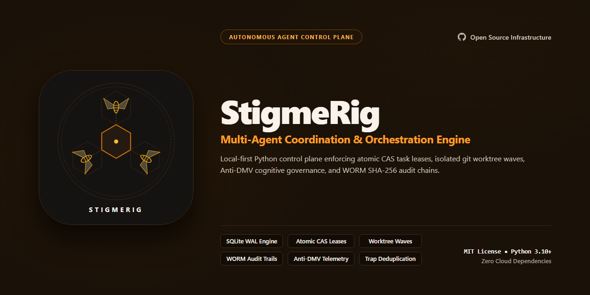
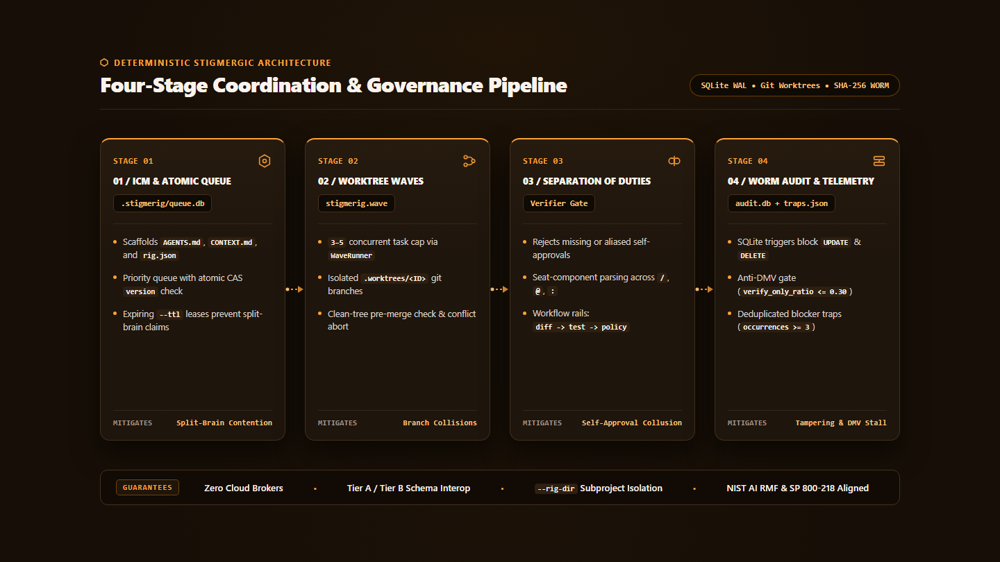

# StigmeRig

[](https://github.com/stigmerig-project/stigmerig/actions/workflows/test.yml)
[](https://opensource.org/licenses/MIT)
[](https://www.python.org/downloads/)

StigmeRig is a sovereign, local-first multi-agent coordination engine.
It coordinates autonomous coding agents through environmental stigmergy without centralized cloud brokers.



## Intellectual Lineage and Provenance

StigmeRig synthesizes foundational concepts across biology, distributed systems, and agent architecture:

- **Pierre-Paul Grasse (1959)**: Formulated biological stigmergy, showing how decentralized social insects coordinate indirectly through environmental modifications.
- **Nate B Jones (`OpenRig`)**: Pioneered sovereign local-first AI architectures, deterministic agent rails, and strict execution-verification separation.
- **Jake Van Clief (`Interpretable Context Model - ICM`)**: Formulated file-over-app execution boundaries, tiered context pruning, and automated orientation scaffolding (`AGENTS.md` and `CONTEXT.md`).
- **Mike (`@FeralMachine`) (`OpenRig`)**: Architected multi-agent civilization topologies, persistent rigs, and progressive disclosure context engineering.
- **Marcus Schwarz (`@mvschwarz`)**: Developed early file-based and SQLite task queues for local agent developer swarms.

## Control Plane Architecture

StigmeRig structures autonomous work across a four-stage deterministic pipeline backed by SQLite WAL state and git worktrees.



1. **ICM and Atomic Queue (`.stigmerig/queue.db`)**: Scaffolds repository orientation files and coordinates priority claims via Compare-And-Swap (`version`) leases.
2. **Worktree Waves (`stigmerig.wave`)**: Bounds concurrent execution to 3 to 5 tasks inside isolated `.worktrees/<ID>` git branches.
3. **Separation of Duties (`Verifier Gate`)**: Blocks missing verifiers and aliased self-approvals while routing handoffs across workflow rails.
4. **WORM Audit and Telemetry (`audit.db` and `traps.json`)**: Enforces trigger-protected SHA-256 hash chains, Anti-DMV governance ratios, and blocker deduplication.

## Swarm Failure Modes and Architectural Defenses

Multi-agent swarms fail predictably when unconstrained. StigmeRig provides deterministic defenses against nine failure modes:

| Swarm Failure Mode | Pathological Behavior | StigmeRig Architectural Defense |
| :--- | :--- | :--- |
| **Split-Brain Contention** | Multiple agents claim the same task simultaneously and overwrite files. | SQLite WAL mode with atomic Compare-And-Swap (CAS) `version` leases and automated `--ttl` expiration. |
| **Self-Approval Collusion** | An implementing agent reviews or approves its own changes via identity aliases. | Rejects missing verifiers and parses composite seat components across `/`, `@`, and `:` delimiters. |
| **Audit Ledger Tampering** | Agents rewrite task history or delete failed execution traces. | Cryptographic SHA-256 WORM hash chain with SQLite triggers blocking `UPDATE` and `DELETE` operations. |
| **Context Window Blowout** | Agents pass unbounded conversational history, exhausting token budgets. | Environmental stigmergy coordinates through compact SQLite state transitions and scoped task files. |
| **Recursive Swarm Traps** | Agents cycle endlessly on edge cases or expand task scope. | Workflow rails guide archetype transitions (`diff_synthesizer` to `unit_tester` to `policy_gatekeeper`). |
| **Verification Bureaucracy ("DMV Trap")** | Review ceremony outnumbers implementation work and stalls delivery. | Tracks `verify_only_ratio <= 0.30`, `dmv_alert`, and `ceremony_ratio` across leaf archetypes. |
| **Amnesiac Repeat Failures** | Agents hit identical blockers repeatedly without retaining institutional memory. | Deduplicates normalized failure signatures in `.stigmerig/traps.json`, flagging `promotion_candidate` at `occurrences >= 3`. |
| **Parallel Branch Collisions** | Concurrent workers corrupt shared working trees or leave half-merged conflicts. | `WorktreeManager` and `WaveRunner` enforce 3–5 wave caps, clean-tree checks, and `git merge --abort` rollback. |
| **Parent-Board Clobbering** | Subproject swarms overwrite root workspace queues, boards, or trap registries. | `--rig-dir` and `STIGMERIG_ROOT` isolate local `queue.db`, `<rig_dir>/Task_Board.md`, and `<rig_dir>/traps.json`. |

## Standards Alignment: NIST AI RMF and SSDF

StigmeRig implements controls aligned with federal and international software assurance frameworks:

- **NIST AI RMF 1.0 (Artificial Intelligence Risk Management Framework)**:
  - `GOVERN 1.2 / 1.3`: Separates roles and enforces organizational boundaries between builders and verifiers.
  - `MEASURE 2.6 / 2.7`: Enforces independent verification and immutable execution telemetry.
  - `MANAGE 2.4`: Limits blast radiuses through git worktree sandboxes and short-lived leases.
- **NIST SP 800-218 (Secure Software Development Framework - SSDF)**:
  - `PO.3.2`: Prevents unauthorized software changes via authenticated task claims.
  - `PS.1.1`: Mandates separation of duties across implementation and verification agents.
  - `PW.1.2`: Records tamper-evident audit trails for all code state transitions.
- **NIST SP 800-53 Rev. 5 (Security and Privacy Controls)**:
  - `AC-3 / AC-4`: Access and information flow enforcement through atomic database leases.
  - `AU-2 / AU-3 / AU-9`: Protection of audit information via append-only cryptographic hash chains.
  - `AU-10`: Non-repudiation of agent claims and verification receipts.

## Core Features

- **Local-First SQLite WAL State**: Coordinates concurrent readers and writers in `.stigmerig/queue.db` with zero network brokers.
- **WORM Cryptographic Audit Ledger**: Protects `.stigmerig/audit.db` with SHA-256 hash chaining and SQLite `BEFORE UPDATE` and `BEFORE DELETE` triggers.
- **ICM Startup Scaffolding**: Generates `AGENTS.md`, `CONTEXT.md`, and `.stigmerig/rig.json` on initialization, writing `.stigmerig/AGENTS.stigmerig.md` when `AGENTS.md` exists.
- **Composite Anti-Self-Approval Gate**: Blocks direct and aliased self-verification across `seat/agent`, `agent@host`, and `role:agent` identifiers.
- **Rolling Git Worktree Waves**: Executes 3 to 5 tasks per batch in `.worktrees/<ID>` with archetype commit attribution and `--no-ff` merges.
- **Anti-DMV and Wave Topology Telemetry**: Computes `verify_only_ratio`, `ceremony_ratio`, epic `phase_depth`, `max_wave_width`, and Mermaid handoff diagrams.
- **Normalized Blocker Trap Harvesting**: Deduplicates recurring failure signatures in `.stigmerig/traps.json` and promotes persistent traps at three occurrences.
- **Tier A and Tier B Schema Interoperability**: Reads flat or nested task files, normalizes event schemas, and isolates `--rig-dir` sandboxes.
- **Zero Runtime Cloud Dependencies**: Built purely on the Python 3.10+ standard library (`sqlite3`, `argparse`, `hashlib`, `subprocess`).

## Installation

Install StigmeRig directly from GitHub using pip or uv:

```bash
pip install "git+https://github.com/stigmerig-project/stigmerig.git@v0.1.3"
```

```bash
uv tool install "git+https://github.com/stigmerig-project/stigmerig.git@v0.1.3"
```

Alternatively, clone the repository for editable local development:

```bash
git clone https://github.com/stigmerig-project/stigmerig.git
cd stigmerig
pip install -e .
```

Verify your installation:

```bash
stigmerig --help
```

## Quick Start: The Four-Step Coordination Cycle

### 1. Initialize Your Repository

Run `stigmerig init` inside any code repository to scaffold the local coordination environment:

```bash
stigmerig init
```

This generates `.stigmerig/rig.json`, initializes SQLite databases, and scaffolds `AGENTS.md` and `CONTEXT.md` onboarding files.
If `AGENTS.md` already exists, it writes `.stigmerig/AGENTS.stigmerig.md` sidecar instructions to prevent overwriting your existing directives.

### 2. Create Tasks

Register work items with priority, archetype, and tags.
Priority ranks lower numbers first, so priority 10 runs before default 100:

```bash
stigmerig task create --id TASK-001 --title "Implement feature" --archetype diff_synthesizer --priority 10
```

### 3. Claim Tasks with Atomic Lease Protection

Agents claim tasks using atomic Compare-And-Swap (CAS) leases. Leases expire after a configurable TTL:

```bash
stigmerig task claim --id TASK-001 --agent AgentAlpha --ttl 1800
```

### 4. Complete Tasks with Independent Verification

StigmeRig enforces separation of duties. The implementation agent cannot approve its own work:

```bash
stigmerig task done --id TASK-001 --agent AgentAlpha --verifier AgentBeta --session-id "session-001"
```

Verify cryptographic hash-chain integrity:

```bash
stigmerig audit verify
```

## Rolling Wave and Git Worktree Orchestration

For concurrent multi-agent execution, `stigmerig.wave` pairs `WorktreeManager` with `WaveRunner` to isolate file mutations per task.

```python
from pathlib import Path
from stigmerig.db import StigmeRigDB
from stigmerig.wave import WaveRunner, WorktreeManager

db = StigmeRigDB()
wt = WorktreeManager()
runner = WaveRunner(db=db, worktree_mgr=wt)

def build_auth(worktree_dir: Path) -> bool:
    (worktree_dir / "auth.py").write_text("def verify_token():\n    return True\n", encoding="utf-8")
    return True

results = runner.run_wave(
    [
        {
            "task_id": "TASK-001",
            "agent": "BuilderAlpha",
            "verifier": "TesterBeta",
            "archetype": "diff_synthesizer",
            "action": build_auth,
        }
    ],
    max_concurrency=3,
)
```

`WaveRunner` enforces four deterministic execution invariants:

- **Bounded Concurrency**: Clamps `max_concurrency` to a ceiling of 5 tasks per wave (recommended 3 to 5).
- **Isolated Task Branches**: Creates `.worktrees/<ID>` bound to branch `task/<ID>` before invoking the worker callback.
- **Archetype Git Attribution**: Commits staged changes under `<Swarm> [<archetype>]` author metadata and `<Swarm> [orchestrator]` committer metadata.
- **Safe Non-Fast-Forward Merge**: Verifies a clean worktree, merges with `git merge --no-ff`, or runs `git merge --abort` on conflict.

## Deterministic Telemetry and Trap Tracking

StigmeRig computes task durations, governance overhead, epic wave shapes, and recurring blockers directly from SQLite logs.

Render a human-readable Markdown summary table:

```bash
stigmerig telemetry metrics
```

Export structured metrics as JSON for automated CI gates or dashboards:

```bash
stigmerig telemetry metrics --json
```

Generate Mermaid sequence diagrams of agent handoffs with `stigmerig telemetry sequence`.

### Anti-DMV Governance Ratios

Swarm pipelines stall when verification tasks outnumber implementation work.
StigmeRig audits leaf tasks against four verify-only archetypes (`unit_tester`, `prose_auditor`, `policy_gatekeeper`, `topology_reader`):

- **`verify_only_ratio`**: Measures verify-only leaf tasks divided by total leaf tasks, targeting `<= 0.30`.
- **`dmv_alert`**: Triggers `true` whenever `verify_only_ratio` exceeds `0.30`.
- **`ceremony_ratio`**: Combines verify-only tasks and `self_execution_override` events divided by total leaf tasks.

### Epic Wave Topology

For tasks grouped under a parent epic (such as `EPIC-01`), StigmeRig analyzes execution intervals:

- **`phase_depth`**: Counts sequential execution waves within the epic.
- **`max_wave_width`**: Measures peak concurrent tasks executing in a single wave.
- **`topology_class`**: Classifies each epic as `single`, `concurrent`, `linear`, or `hybrid_dag`.

### Deduplicated Blocker Traps

Marking a task blocked via `stigmerig task fail` records a normalized failure signature in `.stigmerig/traps.json`:

```bash
stigmerig task fail --id TASK-001 --agent AgentAlpha --reason "SQLite lock timeout on queue.db"
```

Repeated failures matching the same normalized signature increment `occurrences` instead of creating duplicate entries.
When `occurrences` reaches `>= 3`, StigmeRig sets `promotion_candidate` to `true` and surfaces the trap in telemetry reports.

## CLI and Environment Reference

Pass `--rig-dir <path>` before any subcommand to target an isolated `.stigmerig` state directory.

| Command | Purpose | Key Flags |
| :--- | :--- | :--- |
| `stigmerig init` | Initialize SQLite databases, `Task_Board.md`, and ICM files. | `--path <dir>`, `--no-icm` |
| `stigmerig task create` | Register a task in `queue.db` and scaffold its Markdown context. | `--id`, `--title`, `--parent`, `--archetype`, `--priority`, `--tags`, `--author` |
| `stigmerig task list` | Query tasks ordered by priority and creation timestamp. | `--status <todo\|working\|done\|blocked>`, `--parent <id>` |
| `stigmerig task get` | Inspect full JSON metadata for a single task. | `--id` |
| `stigmerig task claim` | Acquire an atomic CAS task lease with expiration TTL. | `--id`, `--agent`, `--ttl <seconds>` |
| `stigmerig task done` | Close a task after independent verification and compute next rail step. | `--id`, `--agent`, `--verifier`, `--session-id`, `--allow-self-approval` |
| `stigmerig task fail` | Mark a task blocked and deduplicate its blocker signature in `traps.json`. | `--id`, `--agent`, `--reason` |
| `stigmerig audit log` | Append a custom SHA-256 hash-chained entry to `audit.db`. | `--task`, `--action`, `--agent`, `--status`, `--payload` |
| `stigmerig audit verify` | Validate genesis continuity and SHA-256 digests across `audit_log`. | None |
| `stigmerig board sync` | Regenerate `<rig_dir>/Task_Board.md` from `queue.db`. | None |
| `stigmerig telemetry sequence` | Emit a Mermaid sequence diagram of recorded agent handoffs. | `--task <id>`, `--output <file>` |
| `stigmerig telemetry metrics` | Export task durations, Anti-DMV ratios, wave shapes, and recurring traps. | `--json`, `--output <file>` |

Environment variables configure default runtime resolution:

- **`STIGMERIG_ROOT`**: Overrides the default `.stigmerig` directory when `--rig-dir` is omitted.
- **`STIGMERIG_SEAT`**: Sets explicit seat attribution in completion audit payloads (falls back to `AGENT_SEAT` or agent prefix).
- **`STIGMERIG_SWARM_NAME`**: Customizes git author and committer prefixes for `WorktreeManager` and `WaveRunner` commits.

## Multi-Harness Integration Guide

StigmeRig coordinates autonomous agents across heterogeneous developer environments without proprietary plugins.

### Claude Code

Point Claude Code to StigmeRig in your project `CLAUDE.md`:

```markdown
## Task Coordination via StigmeRig
- Check active tasks before starting work: `stigmerig task list --status todo`
- Claim a task before editing files: `stigmerig task claim --id <ID> --agent claude-code`
- When complete, trigger verification: `stigmerig task done --id <ID> --agent claude-code --verifier human`
```

### Cursor and Windsurf

Add instructions to `.cursorrules` or `.windsurfrules`:

```markdown
Always inspect .stigmerig/rig.json and CONTEXT.md on session start.
Coordinate changes using `stigmerig task claim` and verify audit integrity before finishing.
```

### Cline and Roo Code

Include StigmeRig workflow rails in your custom system prompt:

```markdown
You operate under StigmeRig coordination. Read active assignments via `stigmerig task list`.
Never modify files without holding an active task claim.
```

### Headless Frameworks (Hermes, OpenHands, Antigravity)

Subagents execute `stigmerig` commands via shell or subprocess calls.
Use `--rig-dir <path>` to target isolated sub-project sandboxes without polluting root workspaces:

```bash
stigmerig --rig-dir ./subproject/.stigmerig task list
```

Running board synchronization inside an isolated rig writes `<rig_dir>/Task_Board.md`.
This updates local status without clobbering root workspace Kanban boards.

### Aider

Pair StigmeRig with Aider across isolated git branches:

```bash
stigmerig task claim --id TASK-002 --agent aider
aider --message "Implement TASK-002 per CONTEXT.md"
stigmerig task done --id TASK-002 --agent aider --verifier human
```

## Tier A and Tier B Interoperability

StigmeRig provides bidirectional compatibility between standalone projects (Tier A) and monorepo agent workspaces (Tier B):

- **Task Markdown Structure**: Supports both flat `tasks/<ID>.md` files and nested `tasks/<ID>/context.md` directories.
- **Audit Chain Verification**: The `stigmerig audit verify` command validates both Tier A seven-field header schemas and Tier B `v2:` hash chains.
- **External Rig Isolation**: Passing `--rig-dir` directs state and task files to the target project, generating `<rig_dir>/Task_Board.md` without clobbering parent boards.
- **Event Schema Normalization**: Telemetry normalizes Tier A and Tier B `task_events` columns and lifecycle verbs into canonical states.
